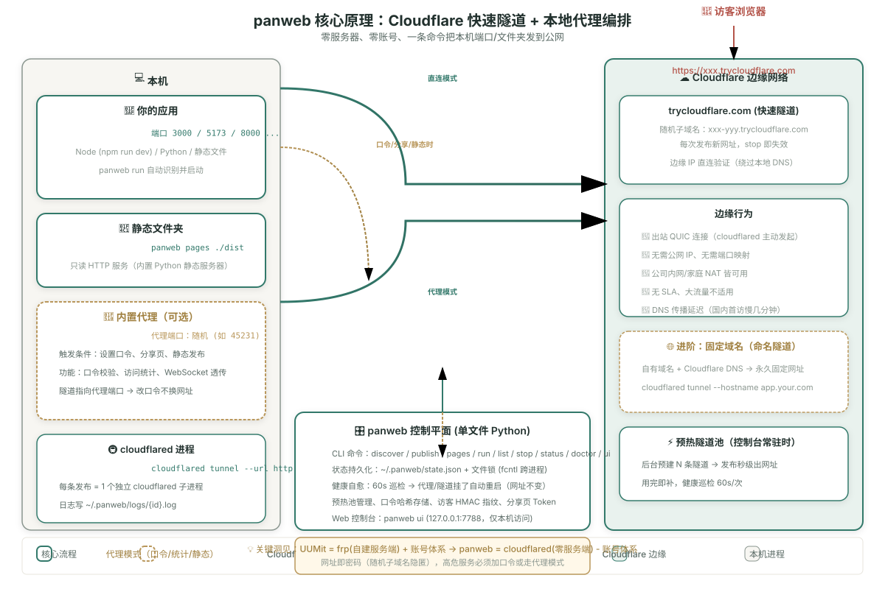

# panweb — 零服务器，把本机应用一键发布到公网

当前版本 **1.6.0**（模块化架构 + 买断许可 + 真终端 / 诊断 / 更新 / 签名公证）。

UUMit 的复刻版（逆向自 UUMit 客户端），用 **Cloudflare 快速隧道** 替代自建 frp 服务端：
不需要申请服务器、不需要账号、不需要实名，一条命令把本机端口或文件夹发到公网。

```bash
panweb publish 3000 --share
# ✅ 已发布：port-3000
#    公网网址：https://xxx-yyy.trycloudflare.com
#    分享页：https://xxx-yyy.trycloudflare.com/__panweb/share/xxxx
```

把网址发给任何人，手机、其他电脑都能直接打开。

---

## 来源：UUMit 逆向结论

用 REA（Reverse Engineer Anything）方法论对 `uumit-connector`（Go 1.27.2，Mach-O arm64）做二进制取证与行为观察，核心发现：

| 证据（观察） | 结论（推断） |
| --- | --- |
| `go version -m` 内嵌 `github.com/fatedier/frp v0.71.0` 及全套依赖（kcp-go、quic-go、yamux、reedsolomon） | **UUMit 的隧道内核就是开源的 frp**（内网穿透事实标准），客户端是定制版 frpc |
| `coder/websocket`、`coreos/go-oidc`、`go-jose` | 控制面走 WebSocket，登录走 OIDC |
| `tjfoc/gmsm`（国密 SM2/SM4） | 配合平台实名认证的合规加密 |
| 每台设备一个子域名（如 `mac-mini-2.uua2a.com`） | 服务端 frps + 泛域名 vhost 路由 |
| 暴露面四档：disabled / private / granted / public | 访问控制全部在平台侧（认证墙），客户端只做转发 |
| `pages` 子命令、`--directory` 只读静态服务 | 文件夹发布 = 连接器本地起静态服务器 + 同一条隧道 |

**UUMit = frp 隧道 + 平台账号/成员/实名/权限层。** panweb 保留前者（换成免服务器的 cloudflared），去掉后者（零账号，网址即密码）。

## UUMit vs panweb

| | UUMit | panweb |
| --- | --- | --- |
| 费用 | 免费档 + 实名认证 | 商业发行版一次买断（14 天试用）；源码开发模式不限制 |
| 需要服务器 | 否（平台方承担） | **否**（Cloudflare 边缘承担） |
| 隧道内核 | frp（自建服务端） | cloudflared 快速隧道 |
| 网址 | 固定设备子域名 | 每次发布随机（重启即变） |
| 权限分档 | 私有/邀请/公开 + 成员管理 | 无（公开，靠随机子域名隐匿） |
| 端口应用发布 | ✅ | ✅ `publish <端口>` |
| 文件夹只读发布 | ✅ | ✅ `pages <文件夹>` |
| 应用发现 | ✅ `apps discover` | ✅ `discover` |
| 固定域名 | ✅ | 进阶：命名隧道（见下） |

## 安装

```bash
git clone <本仓库> panweb && cd panweb   # 或直接拿到 panweb 文件
./install.sh                              # 装到 ~/.local/bin + Agent 技能
brew install cloudflared                  # 唯一外部依赖（install.sh 会检查）
panweb doctor                             # 自检
```

**不想碰终端**：在 macOS 上运行 `make dmg` 得到 `dist/panweb-<版本>-<架构>.dmg`——
双击安装的 macOS App（内置 cloudflared，无需 brew/终端；运行仍依赖 macOS 自带的
python3，缺失时首次启动会引导安装 Command Line Tools），
打开后是本机控制台 <http://127.0.0.1:7788>。默认构建是 ad-hoc 签名、未走苹果公证，
首次打开请右键 →「打开」；配置了 Developer ID 与公证凭据时，同一条 `make dmg`
会自动签名 → 公证 → 装订（见「开发与测试」）。

如果从非 git 渠道拿到文件后提示没有执行权限，先运行 `chmod +x panweb install.sh`。
`doctor` 会同时检查 curl / lsof / gh / npm 等可选工具。

无需 root，无需改网络设备，纯出站连接（公司内网/家庭 NAT 都能用）。

## 命令

| 命令 | 作用 |
| --- | --- |
| `panweb ui` | **启动本机控制台**（浏览器仪表盘，http://127.0.0.1:7788，UUMit 风格） |
| `panweb discover` | 扫描本机监听端口，识别可发布的 HTTP 应用（只读） |
| `panweb publish <端口> [--name 名字] [--share] [--no-check]` | 发布端口上正在运行的应用 → 公网网址；`--share` 额外生成分享页与访问统计；发布后自动按访客视角自检（`--no-check` 跳过） |
| `panweb pages <文件夹> [--name 名字]` | 文件夹发布成只读网页 → 公网网址（自动带分享页与统计） |
| `panweb run <文件夹> [--name 名字] [--share]` | **识别并自动启动项目**（静态/Node），一条命令直达公网；`--share` 生成分享页与统计 |
| `panweb check <id\|名称\|网址> [--no-fix]` | **按访客视角自检已发布的应用**：首页/静态资源/WebSocket 逐项给结论，默认会依据取证自动修正 Host 模式；未通过时退出码 1 |
| `panweb compat <id\|名称> [--host-mode tunnel] [--bearer T \| --user U --password P \| --header Name --value V \| --auth-stdin] [--clear-auth]` | 上游兼容设置：回源 Host 模式、代访客注入应用自己的凭据（密钥只存本机；`--auth-stdin` 从标准输入读，不进进程列表） |
| `panweb list` | 已发布的应用与网址 |
| `panweb stop <id\|名称\|all>` | 停止发布（隧道、静态服务器、由 panweb 启动的项目进程一并结束） |
| `panweb status` / `panweb doctor` | 当前状态 / 环境自检 |
| `panweb license status\|activate\|deactivate` | 查看试用/许可、离线激活、解除本机绑定 |
| `panweb update [check\|apply]` | 查询 GitHub Releases 最新版并**取回升级包**：买断的 1 年更新窗口过期会直接拒绝；下载走 HTTPS、落地后按发布记录核对大小并打印 SHA-256；**不替换正在运行的 App**（拖拽覆盖由你确认） |
| `panweb report [--out 目录]` | 导出**脱敏诊断包** zip：版本/环境/发布状态/最近动态/日志尾部；凭据目录、口令、访客记录与许可密钥本体一律排除，打包后还会自查一遍——混进未脱敏字段就拒绝出包并删掉 |

## 完整链路

```
粘贴项目文件夹 → 自动识别类型（静态 / Node 的 dev/start 脚本）
    → 自动启动（npm run dev…）→ 日志嗅探监听端口
    → 建立出站隧道 → 生成公网网址 → 分享即访问
    → 停止时项目进程、静态服务器、隧道一并回收
```

`panweb run` 或控制台「启动项目」Tab 一次完成全链路；Python 等其他类型请手动启动后用「发布端口」。

## 代码结构（1.6 模块化）

```text
panweb                  # 19 行薄启动器：找到 src/ 并调用 CLI
src/panweb/             # 按职责分包，单文件均 < 500 行
  runtime/errors/store  # 路径、错误、原子状态与跨进程锁
  processes/tunnel      # PID/端口/cloudflared、快速隧道
  pins/visits/share     # 口令、匿名统计、分享页
  proxy/forwarder       # 内置代理、预热隧道池
  publish/entries       # 发布、自动启动、生命周期
  upstream/healthcheck  # 上游兼容层（Host 模式/凭据注入）、访客视角自检
  term                  # 控制台里的真终端：PTY 会话、非阻塞读写、SSE 画面推流
  agents                # 本机 Agent 探测与技能安装、终端可执行的 Agent 白名单
  folders               # 控制台「选文件夹」的本机目录浏览
  supervisor/domain     # 自愈、固定域名
  hosting/convert       # GitHub Pages、Markdown/Excel 转换
  diagnostics           # 脱敏诊断包（打包后自审，混进密钥就拒绝出包）
  codesign              # Developer ID 签名 + 苹果公证（没配凭据退回 ad-hoc）
  update                # 检查 GitHub Releases / 取回升级包，受许可更新窗口约束
  ui_server/ui_actions  # 控制台 HTTP 与 API
  licensing             # 离线买断许可
  cli/cli_commands      # 参数解析与调度 / 命令输出渲染
  mcp_server            # MCP stdio（复用同一批 core_* 函数）
ui/src/                 # 前端源码：6 个 CSS、10 个 JS、2 个 partials + index + manifest
ui/index.html           # tools/build_ui.py 组装的单文件产物（文件头标注「请勿直接编辑」）
site/                   # 项目介绍页：独立静态站（index + 3 CSS + 4 JS），`panweb pages site` 即可发布
tools/build_ui.py       # 前端组装 / --check
tools/build_dmg.py      # macOS 安装包（install-app 造 App → hdiutil 打 dmg）
tools/license_tool.py   # 卖家侧离线签发许可
docs/architecture.md    # 分层、状态机、安全边界、许可与打包
docs/licensing.md       # 许可运营手册
```

依赖规则：底层 `runtime/store/processes` 不依赖业务；`publish` 不依赖 `supervisor/ui`；`domain` 不反向依赖 `entries`。详细分层见 [docs/architecture.md](docs/architecture.md)。

单文件体积由测试守住（`tests/test_build.py`）：启动器 ≤50 行、后端模块 ≤500、前端模块 ≤400、工具 ≤220、测试 ≤320；只有构建产物 `ui/index.html` 与第三方库目录 `ui/vendor/`（qrcode.js、xterm.js）豁免。

## 控制台（`panweb ui`）

对标 UUMit 桌面端的完整 Web 控制台，仅绑定 127.0.0.1（只有本机能打开）。
**布局**：左侧边栏选择模块（我的应用 / 动态与提醒 / 连接 Agent / 终端 / 系统与数据，侧栏可拖拽调宽），选中模块在主区**整幅展示**；五个页面各自独立成篇，互不挤压。

- **我的应用**：空态全屏 Hero 引导；应用卡自包含（网址/内嵌二维码/口令标记/访客数/分享链接/详情抽屉）
- **路径不用复制粘贴**：终端的工作目录、发布弹窗的「发布文件夹」「启动项目」都带「选择…」，弹出本机目录浏览器（只列目录、隐藏项与符号链接不显示，还会提前告诉你这个目录能不能直接发布）
- **动态与提醒**：发布/停止/自愈统计卡 + **访客动态（实时）** + 全宽事件时间线
- **连接 Agent**：UUMit 风格大卡片网格，检测本机 Agent 一键装技能；安装说明复制 + 示例话术
- **氛围层（会呼吸的背景）**：光带 + 颗粒质感 + **隧道流线粒子**三层画在内容背后，粒子走的就是本机→边缘这条链路——在线应用越多流得越密，发布/访客事件从本机节点放一圈脉冲。开销封死：30fps 上限、终端页淡出后彻底停笔、标签页隐藏自动挂起、系统「减少动态效果」时只留一张静构图

**分享页**：代理模式的发布会自动带一个 `/__panweb/share/<token>` 分享页——收到链接的人先看到应用名、说明、有效期、在线状态和口令入口，再进入应用；链接带 OG 预览，适合直接发微信/飞书/邮件。详情抽屉里可编辑说明、预览分享页、生成分享图/文案。没有分享页的直连发布仍然零开销，只是没有统计。

- **顶栏**：标题 + 「N 个应用在线 · 累计停止 X · ⚠ 需要检查」一行统计 + 通道就绪 pill + 发布按钮
- **我的应用**：卡片自包含——网址行（点击打开/一键复制）、内嵌二维码（手机扫码直达）、高危警示、「由 panweb 启动」标记
- **启动项目 Tab**：粘贴项目路径自动识别类型，静态直发、Node 自动 `npm run dev` 并嗅探端口
- **动态页**：发布、停止、访客到达、控制台事件实时记录，4 秒自动刷新

零依赖：Python 标准库 + 单文件前端（QR 库与终端渲染库 xterm.js + fit/canvas 插件放在 `ui/vendor/`，构建时原样内联进产物，离线可用），无 npm、无运行时构建步骤。
修改 `ui/src/` 下的 CSS/JS/HTML 模块后运行 `python3 tools/build_ui.py` 重新生成 `ui/index.html`。

所有命令支持 `--json`：成功输出 `{"ok":true,"data":…}`（退出码 0），失败输出 `{"ok":false,"error":{…}}`（退出码 2/3/8/9），与 uumit-connector 的输出契约一致。
CLI 现在由 `main()` 统一捕获业务错误；`--json` 模式下 stderr 最后一行始终是错误 JSON。
控制台 API 只接受本机 Host/Origin + `application/json`，防止 DNS rebinding 与跨站表单 CSRF。

## 工作原理

```
访客浏览器 ──▶ https://xxx.trycloudflare.com（Cloudflare 边缘）
                     │ 边缘回源（出站隧道，无需公网 IP / 端口映射）
                     ▼
        cloudflared（本机，出站 QUIC 连接）
                     │
                     ▼
        127.0.0.1:3000 你的应用 / panweb 静态服务器（只读文件夹）
```

### 详细架构图（SVG）

<details>
<summary>📐 展开查看完整架构图（访客流 → 边缘 → 隧道 → 本机代理/应用 → 控制平面）</summary>



</details>

### 两种发布模式对比

| 模式 | 触发条件 | 隧道指向 | 特点 |
|------|----------|----------|------|
| **直连** | 纯端口发布、无口令、无分享页 | 应用端口（如 3000） | 零开销、无统计、改口令需换网址 |
| **代理** | 设置口令、`--share`、`pages` 静态发布 | 代理端口（随机） | 口令校验、访问统计、WS 透传、**改口令不换网址** |

状态存于 `~/.panweb/state.json`，日志在 `~/.panweb/logs/`。

## 安全须知（重要）

- **公开访问**：任何拿到网址的人都能打开。随机子域名是"隐匿"不是"认证"，不要发含敏感数据的页面。
- **无密码服务高危**：Ollama、ComfyUI、数据库、管理后台这类没有登录的服务，发出去=任何人可用你的算力/数据。
- **文件夹只读但有边界**：`pages` 不会改动原文件，但文件夹内**非隐藏文件**都可被下载；隐藏文件/目录、指向发布根之外的符号链接会被拒绝。`/`、用户主目录、`/Volumes` 等系统根目录禁止直接发布。
- **控制台不会被发布**：`discover` 与 `publish` 会识别并拒绝 panweb 自己的控制台/代理端口（`internal_port`），避免把本机管理权限暴露到公网。
- **终端页是真终端，会真的动手**：控制台在本机开一个伪终端（PTY），把选好的 Agent 以交互模式跑在里面——等价于你本人在终端里启动它，能改本机文件、能发布出公网网址。可执行文件只从固定白名单解析（PATH 加上 `/opt/homebrew/bin`、`~/.local/bin` 等常见安装目录），argv 固定拼装、不经过 shell，界面传不进路径也传不进命令行，进来的只有「选哪个 Agent」和键盘字节；并发最多 4 个、画面缓冲 300KB 上限、控制台退出时回收子进程。控制台只听 127.0.0.1 并校验 Host/Origin，但请把开终端当成「你把终端交给了它」来对待。
- **口令是哈希存储**：口令文件为 600 权限、加盐哈希，登录失败 10 分钟内 8 次后限流；Cookie 带 `Secure; HttpOnly; SameSite=Lax`。
- **panweb 口令 ≠ 应用登录**：口令只决定"能不能打开这个网址"。应用自己要的账号（Jupyter/Grafana/n8n…）是另一道门，分享页会明确告诉访客进去还要登录；要么访客向主人索取账号，要么主人用 `compat` 代填一份凭据。
- **代填的凭据只在本机**：`compat` 存的 bearer/basic/自定义头写在 `~/.panweb/secrets/<id>.auth.json`（600），只有本机代理进程读取；状态文件、控制台接口、CLI、MCP 与分享页最多出现"已设置哪种凭据"的掩码标签，永不回显密钥；头部名称与值经 RFC 7230 校验，拒绝 CR/LF 注入，也不允许覆盖 `Host`/`Connection`/`Upgrade`/`Content-Length`。
- **回源 Host 默认是本机地址**：应用自己的 Host/Origin 校验因此仍然生效。`--host-mode tunnel` 会把访客看到的公网 Host 转交给应用——这是为了绕过 Jupyter/Grafana 的"未知 Host"拦截，等于让应用把公网域名当成可信来源，请在确实需要时再开。
- **访客统计不存原始 IP**：访问指纹用本机随机密钥做 HMAC 后只存短哈希；只记录文档级请求，不记录静态资源、接口、WebSocket 或机器人预览。
- **分享页只对代理模式生成**：分享页本身是公开的（只展示应用名/说明/有效期/在线状态），口令仍保护应用内容；链接带 `noindex` 与 `no-referrer`，不会把 token 带到应用里。
- **网址随发布变化**：快速隧道每次 `publish` 都是新的随机网址，`stop` 后立即失效。

## 已知限制

- **DNS 传播**：部分网络（尤其中国内地）对新生子域名解析慢，首次过早访问可能失败几分钟。panweb 内部用 Cloudflare 边缘 IP 直连验证，不受此影响；访客打不开时等几分钟再试。自检会把这种情况归为「本机解析不到，但隧道在响应」，不会误报成应用坏了。
- **QUIC 被吃掉时自动改走 HTTP/2**：有些网络会静默丢弃 UDP 443，cloudflared 拿到网址却撑不过几十秒，访客侧永远是 530。panweb 会探测一次（结果按进程缓存），不通就加 `--protocol http2`；也可以用 `PANWEB_TUNNEL_PROTOCOL=quic|http2|auto` 强制。
- **速率**：Cloudflare 官方对快速隧道无 SLA，大流量/生产场景不适用。
- **访问统计/分享页只在代理模式可用**：`pages` 和设置口令的发布默认经过内置代理；端口发布在控制台勾选「分享页 + 访问统计」或 CLI 加 `--share` 才走代理。默认直连发布零开销，不记录统计。
- **上游兼容同样只在代理模式可用**：直连发布的链路里没有 panweb，`compat` 会直接告诉你"改了也不会生效"并给出切到代理的做法（详情抽屉里的控件也会置灰），不会留下一个看起来已设置、其实没生效的开关。
- **自检约 20 秒预算**：`panweb check` 会真的打开首页并抽样引用资源，直连发布首次加口令会换网址。
- **访客提醒需要控制台运行**：控制台开着时，访客打开分享页/应用会发 macOS 系统通知（可在「系统与数据」关闭）；控制台关闭后不再提醒。
- **静态发布**：不提供目录列表；隐藏文件不公开；无扩展名的深链接会回退到 `index.html`（支持 SPA）。
- **许可是离线的**：不联网校验，也没有在线吊销；设备绑定是本地记录，试用状态可被删除文件重置。详情与取舍见 [docs/licensing.md](docs/licensing.md)。

## 🌐 云端托管（关电脑也能访问）

把静态内容上传到 **GitHub Pages**（免费、网址固定、全球 CDN）——发布之后**电脑关机也能访问**：

```bash
gh auth login              # 一次性授权（托管功能的前提）
panweb host 报告.md --name 十月销售报表     # Markdown 自动转网页
panweb host 销售数据.xlsx                   # Excel 自动转表格页
panweb host ./dist --name 我的项目          # 整个静态站点
```

控制台「发布应用 → 云端托管」Tab 支持多选文件上传。Markdown/Excel **自动转换**为美观网页，托管项显示在应用列表（🌐 徽标），支持重新部署。仓库为公开，请勿上传敏感内容。

> 动态应用（Node/Python 服务）无法离线访问——它们必须常驻运行，这类内容用隧道发布。

## 独立控制台

控制台不依赖终端窗口，可长期后台运行：

```bash
panweb console start     # 后台守护运行（关闭终端不影响），自动开浏览器
panweb console stop      # 停止后台控制台
panweb install-app       # 生成 ~/Applications/panweb.app，双击即启动（可拖入程序坞）
panweb status            # 查看运行状态（含后台 pid）
```

已发布的网址**不受控制台启停影响**（隧道是独立进程）；控制台重启时会自动恢复池化通道。

## 关机后还能访问吗？

| 应用类型 | 关机后 | 怎么办 |
| --- | --- | --- |
| 动态应用（Node/Python 服务） | ❌ 立即下线 | 服务本身要放到常驻环境（云服务器/免费容器），panweb 的隧道只负责把本机服务带到公网 |
| 静态网页（HTML 文件夹） | ❌ 立即下线，但**可以上云** | `panweb pack <文件夹>` 导出 zip → 上传到免费静态托管（Cloudflare Pages / Netlify / Vercel）→ 地址固定、永久可访问 |

原理：隧道是"反向代理到你这台电脑"，电脑一关，源站就没了——这是所有隧道类产品（UUMit/ngrok 同理）的共性。控制台「系统与数据」页内置了离线导出工具和说明。

## 体验层与生态

| 模块 | 说明 |
| --- | --- |
| ⏳ 时效链接 | 发布时可选 1 小时 / 1 天 / 7 天，到期自动收回（防忘记关；收回依赖控制台运行） |
| 🪪 分享页 | 代理发布自动生成 `/__panweb/share/<token>` 分享首屏：应用名、说明、在线状态、到期倒计时、口令入口、OG 预览 |
| 🔔 访客提醒 | 控制台运行时，访客打开分享页/应用即发 macOS 通知；动态页显示实时访客事件，可在系统页关闭 |
| 🖼 分享卡片 | 应用详情里一键生成精美分享图（分享页二维码+口令提示+有效期+水印）与文案，微信直发 |
| 🌐 固定域名向导 | 授权 Cloudflare → 填域名 → 自动建隧道/写 DNS → 应用绑定，网址永久不变（需自有域名） |
| 🔔 通知中心 | 通道自愈、到期收回等事件 → 系统通知 + 站内红点 |
| ⌘K 命令面板 | 发布 / 停止 / 打开 / 切换主题，键盘流一等公民 |
| ⚡ 首次运行引导 | 缺 cloudflared 时界面内一键安装 |
| 🖥 菜单栏常驻 | Swift 编译的原生菜单栏（在线应用数 + 停止全部 + 打开控制台） |
| 🔌 MCP Server | `panweb mcp` 以 MCP stdio 协议暴露 9 个工具（含自检与上游兼容设置），任何 MCP 客户端可接入 |
| 📊 统计增强 | 24 小时 / 7 天视图切换 + 分享页浏览/应用打开拆分 + 设备/浏览器/国家/来源分布 |
| 🧬 一键诊断包 | 「系统与数据」页或 `panweb report` 导出脱敏 zip（版本/环境/发布状态/动态/日志尾部）；凭据目录、口令、访客记录与许可密钥本体不打包，出包前还会自审一遍 |
| ⬆️ 检查更新 | 界面与 `panweb update` 都能查 GitHub Releases 最新版；买断的 1 年窗口内可取回升级包（核对大小、打印 SHA-256），过期如实拒绝——**不偷偷替换正在运行的 App** |

## 进阶能力

| 模块 | 说明 |
| --- | --- |
| ⚡ 极速发布 | 控制台常驻预热隧道，发布**秒级出网址**（命中预热池时约 1-2 秒） |
| 🔐 访问口令 | 发布时或事后在详情里设置口令（`--pin` 或 `--pin-stdin`，后者不会出现在进程列表）；**已走代理的发布热生效不换网址**。直连发布首次加口令会重新发布并更换网址。代理模式支持 WebSocket（ComfyUI 等） |
| 🩺 健康自愈 | 每 60 秒巡检：代理死亡自动重启（网址不变）、隧道 502/530 或失联自动重连；探测超时连续 3 次才重建，避免网址抖动；应用自己挂掉时不空转 |
| 🔬 访客视角自检 | 隧道通了不等于打得开。发布后自动以访客身份走一遍公网：首页状态、静态资源 404/未编译源码、WebSocket 握手，结论写进条目并在命令行/详情抽屉/应用卡/分享页四处同源展示；发现应用在做 Host 校验会先取证再切 `host_mode`，切了仍被拒就回滚。`panweb check <应用>` 随时重跑 |
| 🔑 上游兼容 | 复杂应用（Jupyter/Grafana/n8n/Open WebUI 等）常见两道墙：Host 校验、需要自己的登录。前者用 `--host-mode tunnel` 把访客的公网 Host 原样传给应用；后者用 `compat` 存一份 bearer/basic/自定义头，由本机代理代访客注入——密钥只落 `~/.panweb/secrets/<id>.auth.json`（600），不进状态文件、不出现在界面/CLI/分享页返回值里 |
| 📊 访问统计 | 代理模式应用的访客数/访问次数、分享页浏览与应用打开拆分、24 小时/7 天走势、设备/浏览器/国家/来源（详情抽屉内）；直连发布不统计 |
| 🌓 深色模式 | 墨青暗色主题，跟随系统 + 手动切换，记忆偏好 |
| 🗂 详情抽屉 | 网址/统计/改名/口令/实时日志一站式管理 |
| 🤖 Agent 连接器 | 检测本机 Agent（Claude Code/Codex/ZCode/通用目录/OpenCode），一键安装 panweb 技能（只写技能目录）；装好用「把 3000 端口发出去」对话即发布；支持复制安装说明接入任意 Agent |
| 💻 真终端 | 控制台里挂的是**真终端**（伪终端 PTY + xterm.js）：选本机已装的 Agent（Claude Code / Codex / OpenCode）和工作目录，以交互模式跑起来——彩色界面、进度条、分页器、Ctrl+C、↑↓ 翻历史都照原样，网页里的键盘直通它手上；画面按字节用 SSE 推回来，换个标签页接着看，关掉页面 Agent 不停。让它替你 discover → publish → check 完成部署 |
| 📐 三栏工作台 | 左（导航）/中（应用）/右（动态·连接器）三栏，拖拽手柄手动伸缩，宽度记忆 |

安全架构：设置口令或分享页的发布经由 panweb 内置代理（口令校验 + 访问统计 + WebSocket 透传），隧道只指向本机 127.0.0.1，源站永不直接暴露；无口令/分享的发布默认直连（零开销）。控制台启动时自动清理孤儿代理/预热隧道、回收**没有归属的 cloudflared 快速隧道**（父进程已退出、不在状态里、目标端口也不再监听才动手）并恢复池化通道；退出时回收预热池与终端会话。界面是每次请求现读的、后端是进程加载时的，版本错配时控制台会直接提示"这个功能要重启才生效"。

## 进阶路线

1. **固定域名（免费）**：注册一个域名接入 Cloudflare（免费版），用 `cloudflared tunnel` 命名隧道绑定 `app.你的域名.com`——网址永久不变，仍零服务器。
2. **完全自主**：租一台最便宜的 VPS 跑 frps（`fatedier/frp`，UUMit 同款内核），泛域名解析即可自建整套 UUMit。
3. **国内直连优化**：花生壳/cpolar 等国内隧道有免费档，可按 panweb 的引擎接口替换。

## Agent 技能

`install.sh` 会把 `skill/panweb-publish` 安装到 `~/.agents/skills/`。之后对 Agent 说：

> 「把 3000 端口发出去」「发布这个文件夹」「让我手机上能打开」

Agent 会按技能里的安全规则执行（默认最窄、高危目标先确认）。

## 买断许可（离线）

商业发行版采用**一次买断、永久使用、含 1 年更新、默认 2 台设备**：

```bash
panweb license status                 # 试用天数 / 激活状态 / 本机指纹
panweb license activate "PWV1.…"      # 离线签名密钥，不联网校验
panweb license deactivate             # 换机前解除本机绑定
```

- 首次运行开始 **14 天试用**；到期后仍可查看/停止已有发布，但不能新建发布或云端托管。
- **1 年更新**落在 `panweb update`：窗口内可取回新 dmg，窗口过期后命令直接拒绝（`license_expired`），已装版本继续可用不受影响——买断的"永久使用"与"限时更新"是两件事。
- 许可是 RSA PKCS#1 v1.5 + SHA-256 离线签名，与本机指纹绑定；不建账号、不上传设备信息。
- **源码开发模式**：仓库默认不含公钥，`mode=development`，不限制功能；发行构建由所有者生成密钥并把公钥放到 `assets/license_public_key.pem` 后启用校验。
- 卖家侧签发与构建流程：见 [docs/licensing.md](docs/licensing.md) 与 `tools/license_tool.py`。
- 本仓库自身尚未声明 LICENSE；公开分发前请由所有者补充 EULA/版权声明。

## 开发与测试

```bash
python3 tools/build_ui.py          # ui/src + QR 库 → ui/index.html
python3 tools/build_ui.py --check  # CI：检查产物是否最新
python3 -m unittest discover -s tests -v
make test                          # 等价于上面两步
make dmg                           # macOS 安装包 → dist/panweb-<版本>-<架构>.dmg
```

打 `v*` 标签会触发 [release workflow](.github/workflows/release.yml)：在 macOS 上跑测试、
构建 dmg/pyz、生成 `SHA256SUMS` 并创建 GitHub Release。`panweb update` 下载后会
按这份清单校验 SHA-256；清单缺失时仍会提示“无校验清单”。

- `tests/` 按主题平铺（不是按包分层）：路径/状态/访问/许可/管道单元测试、CLI 合约、代理分享页/PIN/过期、WebSocket 透传、上游兼容（转发头构造、凭据归一化与注入拒绝）、访客自检（结论判定/资源抽样/裸 TLS WebSocket/Host 取证修正）、隧道传输（QUIC 探测与 http2 回退）、真终端（假 Agent 跑在 PTY 里，验证 argv 白名单、尺寸传递、退出码、缓冲上限与 SSE 游标补发）、自愈与孤儿隧道回收（死隧道不进取用池、恢复未验证通过就不写状态）、诊断包（脱敏字段与"混进密钥就拒绝出包"的自审）、签名与公证（没配身份退回 ad-hoc、配了就先里后外）、更新（版本比较、按架构挑包、许可窗口拒绝、下载大小核对与 SHA-256）、控制台安全、前端构建与模块体积约束、子进程代理集成（真实拉起 `_spawn_proxy` 后转发/分享页/口令/代填凭据）。
- **发行构建的可控项**（都靠环境变量，缺省即安全退回）：`PANWEB_SIGN_IDENTITY`（Developer ID 身份，空则 ad-hoc）、`PANWEB_NOTARY_PROFILE` 或 `PANWEB_APPLE_KEY_ID`/`PANWEB_APPLE_ISSUER_ID`/`PANWEB_APPLE_P8`（公证凭据，缺则跳过公证）、`PANWEB_RELEASE_REPO`（更新来源仓库，默认 `pyf2818/panweb`）、`PANWEB_LICENSE_PUBKEY`（发行时注入公钥后许可校验才生效）。
- 状态目录可用 `PANWEB_HOME` 隔离（测试与便携模式）；panweb 拉起的代理/控制台子进程会继承它。
- CI：`.github/workflows/test.yml` 在 Python 3.9/3.11/3.12 上跑语法编译、208 项测试、前端产物一致性检查与 zipapp 构建；另设 macOS job 验证 App/dmg 打包与内置许可文件，ruff 只拦语法/未定义名这类真错误，覆盖率下限 50%（子进程测试不计入，当前实测约 55%）。
- 第三方组件与许可证：见 `THIRD_PARTY_NOTICES.md`（cloudflared Apache-2.0、QR 库 MIT）。
- 打包 macOS App：`panweb install-app`（复制包、UI、技能、第三方声明与可选许可公钥；
  Python 仍用系统解释器）。
- 打包单文件分发：`python3 tools/build_zipapp.py` → `dist/panweb.pyz`（含 UI/技能/公钥，可独立运行）。
